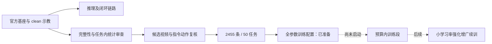

# LingBot-VLA 2：从数据审查到预算约束下的后训练方案

蚂蚁灵波具身大模型挑战赛的实践记录。重点记录**为什么这样做、实际执行了什么、据此如何选择下一步训练方案**。

**本项目独立训练：从官方基座开始，不接队友权重；以后只续训自己产出的 checkpoint。** [时间与 GPU 取舍](configs/efficiency.md)

**当前进度（2026-10-24）：官方基座推理与单回合闭环已运行；数据筛选与复核已完成当前队列；全参数训练配置已准备，自己的模型训练尚未启动。** 本仓库目前没有自训模型权重、训练 loss 曲线或正式万回合成绩。

## 我想解决的问题

只有 50 个任务、每任务 50 条 clean 示教，目标却包括 randomized 场景。我的思路分成两条：先处理示教中的明显完整性问题和指令/动作矛盾，再把训练投入放在模型适配和视觉泛化上。数据筛选服务于训练，不把持续删数据本身当作提分方法。

## 实际做过什么

| 阶段 | 做法及原因 | 实际结果 |
|---|---|---|
| 官方链路 | 在 AMD W7900D 上加载官方基座，先排除环境与调用链路问题 | 有效闭环执行 400 步、16 次动作调用，正常退出；`adjust_bottle` 结果 **0/1** |
| 第一轮数据审查 | 按任务计算运动统计，结合完整性检查，避免跨任务统一阈值 | 2500 → 2479 条，实验性排除 21 条 |
| 数值复查 | 检查时间对齐、重复、静止段、关节跳变；异常先进入复核队列 | 复查 2479 条，新增剔除 0；挑出 10 条优先看视频 |
| 10 条视频复核 | 结合三视角和峰值附近画面，检查统计峰值是否对应真实问题 | 保留 9、排除 1；发现一条面包任务左右臂指令与演示矛盾 |
| 指令语义审查 | 对照任务源码、夹爪序列与手臂角色，扩展检查同类问题 | 再排除 23 条条件推断的指令/动作冲突，得到 **2455 条、540182 帧** |
| 剩余 33 条视频 | 完成此前待复核候选，避免把异常标记直接当坏数据 | 33 条全部保留，数据集不变 |
| 122 条多臂指令 | 检查夹爪事件与手臂角色，并记录时序措辞软问题 | 新增剔除 0；4 条软问题保留原标签 |
| 训练路线调整 | 吸收参赛者公开经验，从原先 LoRA 设想转为全参数训练与分阶段增广 | 配置、强增广接入、本地统计与保存释放脚本已完成离线检查；未启动训练 |

这些是数据处理和运行结果。**没有用筛后数据训过模型，因此尚不能声称筛选提高了成功率。** 视频全程采用抽帧浏览、关键片段更密集查看，不宣称对全部 2455 条进行人工逐帧成功确认。

## 训练思路如何确定

1. **全参数微调作为主路线。** 参考参赛者对训练量与 LoRA 的建议，并使用 AMD 参考仓库已有的 Full-SFT、FSDP2 与完整 depth/video teacher 路径。
2. **基座训练和已有模型续训使用不同学习率。** 基座段配置为 `1e-4`；自己已训练的合规 checkpoint 的续训模板为 `2e-5`。还没有产出自己的 checkpoint，不能把基座初始化写成续训。
3. **增强视觉泛化。** 采用公开的“10% 原图、90% 随机组合增广”方向，整理颜色、缩放平移、遮挡、噪声、模糊、JPEG 配方。只扰动图像观测，保持动作、任务语义和场景结构。
4. **不把所有经验混成一个未经说明的大配置。** 暂不加入未公开具体做法的 MoE、RTC、权重平均等改动。任务均匀采样、低运动窗口降权也没有冒充已经实现。
5. **预算先约束训练段，再确定步数。** 参考速度用于估算，不把其他卡型的耗时或别人的成绩写成我们的结果。

这是直接采用公开经验作工程决策，不额外复现作者的消融实验。完整参数、来源与接入状态见 [训练配置说明](configs/README.md) 和 [经验来源](docs/references.md)。

## 当前计划训练配置

| 项目 | 计划 |
|---|---|
| 模型 | 官方 `robbyant/lingbot-vla-v2-6b` 基座 |
| 数据 | 50 任务，2455 条筛后 clean 示教；不增加 randomized 训练轨迹 |
| 优化方式 | 全参数 AdamW；完整 current/future depth + DINO-video teacher |
| 分布式 | 8 卡 FSDP2 full-shard、gradient checkpointing |
| Batch | 每卡 16 × 8 卡 × 梯度累积 2 = **256** |
| 学习率 | 基座 `1e-4`；已有模型续训模板 `2e-5` |
| 动作块 | 50 |
| 预算段 | 8 卡配置上限 250 optimizer steps；另需外部时间截止与释放流程 |
| 保存 | 完整 DCP，含优化器状态；目标目录为持久化 `/workspace` |

**强增广已通过固定版本补丁接入当前／未来帧与 teacher 输入。** 未公开的强度采用显式工程默认值，前景保护是保守图像启发式，并非语义分割。筛后统计已在本机计算；预算保存和官方 RCC 释放控制器已做离线模拟。尚未部署云实例或验证 GPU 训练。详见 [启动准备与操作流程](docs/training-readiness.md)。

## 预算取舍

32 credits 上限，扣除两次视频复核的已用/预留共 2，保守剩余 **30 credits**。当前账号页面只显示 1 卡和 8 卡；没有四卡入口。

| 方案 | 可用性 | 本轮计费上限 | 预留开销后净训练时间 | 参考估计步数 |
|---|---|---:|---:|---:|
| 8 卡 | 当前可选 | 24 credits / 3 小时 | 约 **2 小时** | 理想约 291；配置先设 250 |
| 4 卡 | 仅备选，当前不可选 | 28 credits / 7 小时 | 约 6 小时 | 理想约 521；备选配置设 500 |

步速采用 AMD 参考仓库的短容量测试，并非我们的训练实测。保存大 checkpoint、数据准备和强增广均可能减少实际训练步数。**这个预算能覆盖有限训练段，不能覆盖帖子中的两万多步长训。** [预算计算与截止安排](configs/README.md)

新增：[GitHub 复用调查](docs/github-reuse-review.md)。仅采纳与本路线兼容的实现；外部成绩仍属于原作者。

## 阅读路径

- [方法与决策记录](docs/methodology.md)：筛选依据、误删风险、为什么停止扩大筛选。
- [实验记录与证据索引](docs/experiment-log.md)：每阶段执行状态及原始汇总。
- [训练配置与预算](configs/README.md)：基座配置、续训模板、强增广规格及启动前依赖。
- [参考来源](docs/references.md)：官方代码、AMD 文档、五篇参赛者笔记。
- [复现范围](docs/reproduction.md)：脚本环境、数据恢复要求和未完成项。

## 仓库收录范围

公开的是方法说明、配置、筛选/审查脚本、必要的决策记录和结果摘要。原始视频、动作数据表、模型权重、账号信息、SSH 密钥和云实例连接信息不在仓库中。历史报告按当时状态保留；最新状态以本 README 与配置说明为准。

项目过程中使用 Codex 辅助代码、数据审查和资料整理；仓库区分已执行证据、外部经验和后续计划。后续实际训练后，再补充配置版本、训练日志、checkpoint 来源与正式评测结果。
